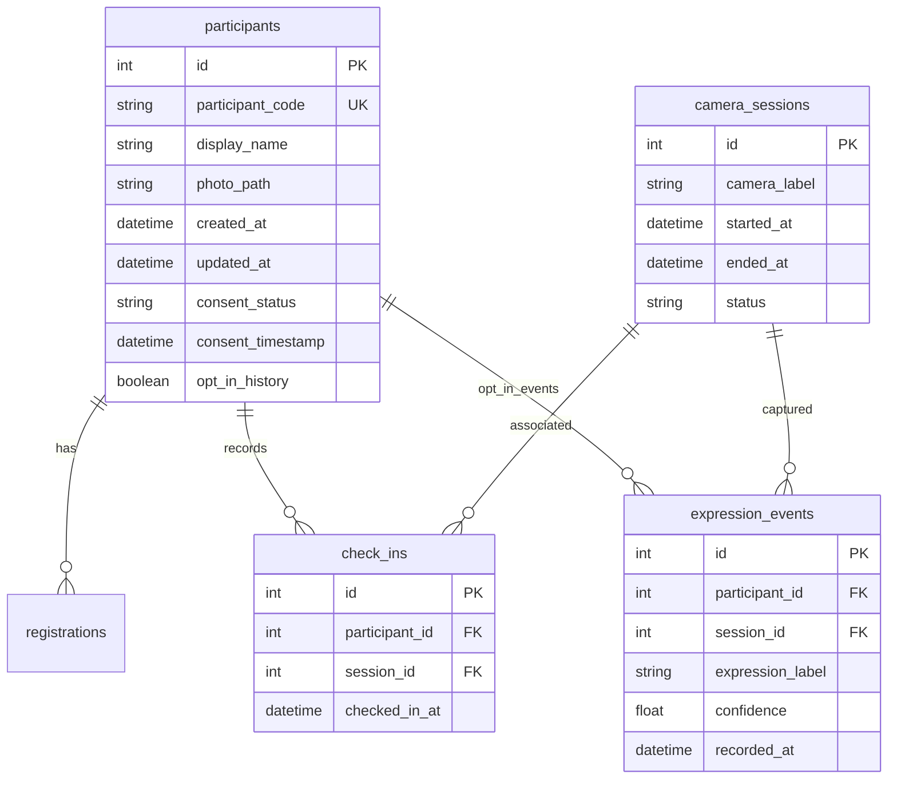

# FaceSense AI — Real-Time Facial Mood & Feeling Analytics System

FaceSense AI is a complete, modern, production-grade web application engineered with **React.js (Vite + TypeScript + Tailwind CSS)** and a **Python (FastAPI + OpenCV + MediaPipe + WebSockets)** backend. It interfaces with real hardware cameras (integrated webcams, external USB cameras) to detect and track human faces in real time, classify visible facial expressions, manage consent-based participant records with quality-checked snapshot storage, and present professional analytics dashboards.

> [!IMPORTANT]
> **Ethical & Scientific Disclaimer:**
> FaceSense AI estimates visible facial muscle configurations and action units according to the Facial Action Coding System (FACS). Predictions represent **estimated facial expressions** and do not claim to determine a person's genuine internal psychological, psychiatric, or emotional state. Unregistered bystander imagery is never retained.

---

## 🌟 Key Features

1. **Hardware Device Camera System**
   - Accesses real connected cameras via browser WebRTC `navigator.mediaDevices.getUserMedia()`.
   - Enumerates laptop webcams and external USB cameras with live switching on the fly without page refreshes.
   - Preserves selected camera in `localStorage`.
   - Displays live ingestion FPS and native stream resolution (e.g., 1280x720 HD).
   - Fullscreen mode, stream pause/resume, and auto-reconnection on hardware disconnection.

2. **Live Multi-Face Detection & Facial Expression Analysis**
   - Autonomous face detection with MediaPipe FaceLandmarker (478 3D landmarks + 52 FACS action unit blendshapes) with OpenCV fallback.
   - Tracks multiple faces simultaneously within the active session using normalized coordinates and centroid/IoU matching (`T001`, `T002`...).
   - Classifies 7 expression categories: **Happy, Sad, Angry, Surprised, Neutral, Fearful, Disgusted** (+ **Uncertain** if below confidence threshold).
   - Temporal Exponential Moving Average (EMA) smoothing across frames to eliminate label flicker.
   - Dynamic color-coded bounding boxes and badges mirrored for natural webcam interaction.

3. **Consent-Based Participant Registration & Quality-Checked Snapshots**
   - Faces are tracked anonymously during the active session.
   - Dedicated participant consent dialog requires explicit approval before image persistence.
   - Automatically selects the highest quality face crop candidate from active tracking.
   - Multi-point quality verification:
     - Sharpness check via Laplacian variance (`cv2.Laplacian(gray).var()`).
     - Mean brightness luminance check (neither underexposed nor washed out).
     - Minimum face bounding box dimensions.
   - Creates a normalized participant record (`P00001`), saves photo to `/storage/snapshots/`, and links the active session track.

4. **Returning Participant Check-In**
   - Registered participants can check in by selecting or searching their participant code/name.
   - Links their authorized record to the active session track.
   - Does **not** re-register, does **not** create duplicate database records, and avoids capturing duplicate permanent snapshots.
   - Opt-in expression history collection: records emotion events only if the participant explicitly agreed during registration.

5. **Facial Mood & Feeling Analytics Module**
   - **Overview Metrics**: Total registered participants, active face tracks, new registrations today, returning check-ins today, predictions today, top predicted feeling with percentage.
   - **Interactive Charts (Recharts)**:
     - Expression distribution pie/donut chart.
     - Daily expression analysis stacked bar chart (last 7 days).
     - Weekly expression activity line/area chart.
     - New registrations vs returning check-ins cohort chart.
     - Model confidence distribution histogram buckets.
     - Camera session activity timeline with event counts and status.

6. **Participant Gallery & Profile Management**
   - Responsive cards displaying snapshot photo, ID, optional name, last observed expression, registration timestamp, total check-ins.
   - Search by code or name, multi-criteria sorting (newest, oldest, name, code), and pagination.
   - **Participant Detail Modal**: Snapshot preview, confidence history line chart, check-in history logs, JSON and CSV data exports, and permanent deletion of both record and image file.

7. **Theme & UI/UX**
   - Premium SaaS dark mode default (`#080D1A` background, `#111827` surface cards, `#6366F1` indigo primary, `#06B6D4` cyan accent).
   - Full light mode support with seamless toggle.

---

## 🛠️ Technology Stack

| Layer | Technologies |
|---|---|
| **Frontend** | React 18, Vite 5, TypeScript 5, Tailwind CSS, Lucide React, Framer Motion, Recharts, React Router v6, Axios, WebRTC MediaDevices API |
| **Backend** | Python 3.12+, FastAPI, Uvicorn, WebSockets, OpenCV (`opencv-python-headless`), MediaPipe 1.2+, NumPy, SQLAlchemy, Pydantic v2 |
| **Database** | SQLite (Default, multi-threaded) • PostgreSQL-ready via SQLAlchemy ORM |
| **Testing** | Pytest, HTTPX, FastAPI TestClient |

---

## 📁 Project Architecture

```
facesense-ai/
├── frontend/
│   ├── src/
│   │   ├── components/
│   │   │   ├── common/       # Navbar, Sidebar, StatCard
│   │   │   ├── scanner/      # CameraFeed, FaceOverlayCanvas, TrackCard, CameraControls, Modals
│   │   │   ├── analytics/    # Recharts (Pie, Bar, Area, Cohort, Confidence)
│   │   │   └── participants/ # ParticipantCard, ParticipantDetailModal
│   │   ├── contexts/         # ThemeContext, ScannerContext
│   │   ├── hooks/            # useCamera, useTheme
│   │   ├── pages/            # 8 dedicated pages
│   │   ├── services/         # Axios API client, WebSocket client
│   │   ├── types/            # TypeScript interfaces
│   │   ├── App.tsx
│   │   ├── main.tsx
│   │   └── index.css
│   ├── package.json
│   ├── vite.config.ts
│   └── tailwind.config.js
│
├── backend/
│   ├── app/
│   │   ├── api/              # REST routers: cameras, scanner, participants, analytics, settings
│   │   ├── computer_vision/  # detector, expression_classifier, tracker, quality_checker
│   │   ├── database/         # session, base, seed
│   │   ├── models/           # SQLAlchemy models: participants, sessions, expression_events
│   │   ├── schemas/          # Pydantic v2 schemas
│   │   ├── services/         # participant_service, analytics_service
│   │   ├── websocket/        # connection_manager
│   │   └── main.py           # FastAPI entrypoint, CORS, static mounts
│   ├── models/               # MediaPipe face_landmarker.task
│   ├── storage/              # Stored participant snapshots
│   ├── tests/                # Automated pytest suite
│   ├── requirements.txt
│   └── .env.example
│
├── start_all.bat             # 1-click Windows launcher
├── run_backend.bat           # Dedicated backend launcher
├── run_frontend.bat          # Dedicated frontend launcher
└── README.md
```

---

## 🚀 Getting Started on Windows

### 1. Prerequisites
- Python 3.11+ or 3.12 (Python 3.12 installed in `D:\face_scan_venv` or standard python)
- Node.js 18+ and npm

### 2. Quick 1-Click Launch (Windows)
Double-click `start_all.bat` in the project root, or execute:
```cmd
start_all.bat
```
This opens the FastAPI backend on port `8000` and the Vite React frontend on port `3000`.

### 3. Manual Step-by-Step Launch

#### A. Backend Setup:
```cmd
cd backend
set "PYTHONPATH=."
D:\face_scan_venv\Scripts\python.exe -m uvicorn app.main:app --host 0.0.0.0 --port 8000 --reload
```
- API Root: `http://localhost:8000`
- Interactive Swagger API Docs: `http://localhost:8000/docs`

#### B. Frontend Setup:
```cmd
cd frontend
npm.cmd run dev
```
- Web Application: `http://localhost:3000`

---

## 🧪 Running Automated Tests

Run the backend test suite covering consent handling, participant registration, returning check-ins, duplicate prevention, details retrieval, exports, and cascade deletion:

```cmd
cd backend
set "PYTHONPATH=."
D:\face_scan_venv\Scripts\pytest.exe -v
```

Output:
```
tests/test_api.py::test_root_endpoint PASSED
tests/test_api.py::test_scanner_status PASSED
tests/test_api.py::test_consent_handling_rejected_without_consent PASSED
tests/test_api.py::test_registration_and_deletion_lifecycle PASSED
tests/test_api.py::test_analytics_endpoints PASSED
============================== 5 passed in 2.92s ===============================
```

---

## 📊 Database Schema



---

## 🔒 Privacy & Security Standards

- **Explicit Consent**: Photo storage requires participant approval.
- **Anonymous Session Isolation**: Anonymous bystander faces are tracked with temporary IDs (`T001`) during the session and are discarded upon session termination.
- **Quality Verification**: Substandard or blurry frames are screened out prior to storage.
- **Complete Deletion**: Deleting a participant permanently purges their database records, check-in history, expression history, and physically deletes their snapshot file from disk.
- **Export Rights**: Participants can export their stored records in JSON or CSV format.

